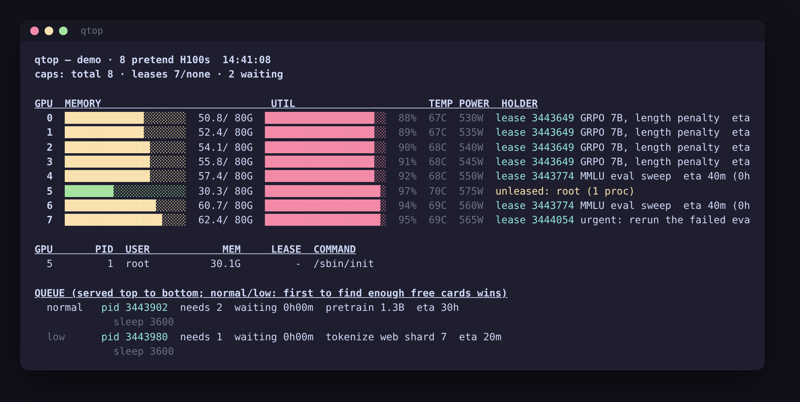

<h1 align="center">gpuq</h1>

<p align="center">
  <b>A GPU queue for one shared machine: your jobs, and your AI agents' jobs,<br>
  wait their turn for free cards instead of piling onto busy ones.</b><br>
  Plain bash and files. No daemon, no root, nothing to configure.
</p>



You have one 8-GPU box and several Claude Code / Codex sessions (and yourself) launching training
runs on it. Everyone picks `CUDA_VISIBLE_DEVICES` by eye, two jobs land on the same card, one dies
of OOM at 3 a.m. **gpuq** fixes that with one rule: *every GPU job asks gpuq for cards*.

```bash
gpuq run -n 2 --note "GRPO 7B" --eta 3h -- python train.py
```

waits until 2 cards are free, then runs the job on them (`CUDA_VISIBLE_DEVICES` set). The job
takes over gpuq's process, so the cards are free again the moment it ends, however it ends, even
`kill -9`. Meanwhile `gpuq status` (or the live `qtop`) shows
who holds what, what each job is, how long it said it would take, and who's next.

## Try it in 30 seconds (no GPU needed)

```bash
git clone https://github.com/EndlessCG/gpuq.git
cd gpuq
./demo.sh        # 8 pretend cards, five real gpuq jobs competing for them, and qtop (q quits)
```

## Install

Needs Linux with `bash` 4+, `flock` (util-linux, already on most systems), `python3` (for qtop),
and `nvidia-smi`.

```bash
git clone https://github.com/EndlessCG/gpuq.git
cd gpuq
./install.sh     # copies to ~/.local/share/gpuq, links gpuq and qtop into ~/.local/bin
```

`./install.sh --uninstall` removes it again. Nothing goes outside your home directory (set
`GPUQ_SHARE` / `GPUQ_BIN_DIR` to install elsewhere); the queue's state is plain files in `~/.gpuq`.

## Use it

| You want to | Run |
| --- | --- |
| run a job on N free cards | `gpuq run -n N [--note TEXT] [--eta 2h] -- CMD...` |
| see the cards and the queue | `gpuq status`, or `qtop` / `gpuq top` for a live view |
| let a long-lived script lease cards itself | `cards=$(gpuq acquire 2 --owner $$)` (lease lasts while that PID lives) |
| be polite | `gpuq run --low ...` waits while any normal job waits |
| jump the queue | `gpuq run --high ...`, or `gpuq prio PID --high --top` for a job already waiting |
| keep a card out of the queue (say, a faulty one) | `gpuq cap --exclude "3"` |
| leave cards for yourself | `gpuq cap --total 6` (your jobs together hold at most 6) |

`--note` is a few words saying what the job is; `--eta` is how long it runs once it has its cards
(`45m`, `2h`, `1h30m`, `1d2h`). `gpuq status` then shows time used and time left for every lease.
`gpuq --help` lists everything.

In qtop, `↑`/`↓` select a waiting job and `H` / `T` / `N` / `L` / `[` / `]` change its priority
(high, top, normal, low, up, down).

## How the queue decides

1. **A card is free** when none of your processes runs on it, no live lease holds it, it isn't
   excluded, and it uses under 5 GB of memory, so other users' jobs are left alone too.
2. **A lease lives exactly as long as its process.** If the job crashes, its cards are free on the
   next check; nothing to clean up.
3. **The priority list goes first.** While a `--high` job waits, it alone may lease; it collects
   free cards one at a time as they come, so a stream of 1-card jobs can't starve an 8-card job.
4. **Then normal jobs**: the first to find enough free cards wins. That's fast, but a steady
   stream of small jobs can keep a big one waiting; give the big one `--high`.
5. **Then `--low` jobs**, which wait as long as any normal job is waiting.

Every change happens under one `flock`, so two jobs can never take the same card.

## Settings

| Setting | Default | Meaning |
| --- | --- | --- |
| `gpuq cap --total N` | every card | most cards your jobs may hold at once (your processes outside gpuq count too) |
| `gpuq cap --lease N` | no limit | most cards leased through gpuq at once (handy as a budget for agents) |
| `gpuq cap --exclude "3 5"` | none | cards never leased |
| `GPUQ_FREE_MIB` | `5000` | a card counts as free below this much used memory |
| `GPUQ_POLL_SECONDS` | `30` | how often a waiting job looks again |
| `GPUQ_DIR` | `~/.gpuq` | where the queue's state lives |

## Tell your AI agents

Agents follow written rules well. Put this in `~/.claude/CLAUDE.md` (Claude Code) and
`~/.codex/AGENTS.md` (Codex):

```markdown
## GPUs: always go through the shared queue (gpuq)
Every GPU job on this machine must lease its cards through `gpuq`; never set
`CUDA_VISIBLE_DEVICES` by hand or start on a card because it looks free.
- Run a job: `gpuq run -n N [--low] --note "<few words>" --eta <duration> -- <command>`.
  Detach long jobs: `setsid nohup gpuq run -n 2 --note "..." --eta 2h -- python train.py &`.
- Scripts that manage their own lifetime: `cards=$(gpuq acquire N --owner $$ --note "..." --eta 1h)`.
- Always pass --note and --eta. Look before launching: `gpuq status`.
- Use --high only when the user asks for it.
```

**Pairs well with [Switchyard](https://github.com/EndlessCG/switchyard)**, a live board of every
Claude Code / Codex session and the experiments they launched, across all your servers.

## How it works

Three files: [`bin/gpuq`](bin/gpuq) (the command), [`lib/gpuq.sh`](lib/gpuq.sh) (the queue, about
180 lines of bash you can source from your own scripts), and [`bin/qtop`](bin/qtop) (the live
view, Python stdlib with curses). State is a folder of tiny files, so you can always see what's
going on with `ls ~/.gpuq` and fix it with `rm`:

```
~/.gpuq/gpu_reservations/gpu3   the PID holding card 3
~/.gpuq/gpu_waiting/<pid>       a waiting job and its class
~/.gpuq/gpu_priority            the priority list, one PID per line
~/.gpuq/gpu_meta/<pid>          a job's note and ETA
```

Is it multi-user? Each user's queue lives in their own home directory, and it already steps around
everyone else's cards because they're busy. To share one queue between several people, point
everyone's `GPUQ_DIR` at the same folder, make it group-writable with the setgid bit
(`chmod 2775`), and have everyone use `umask 002`. Leases and waiting jobs are then shared; the
`--total` cap still counts each person's own processes.

## Tests

```bash
tests/run.sh     # the real gpuq and qtop against a fake nvidia-smi; no GPU needed
```

MIT licensed, see [LICENSE](LICENSE).
